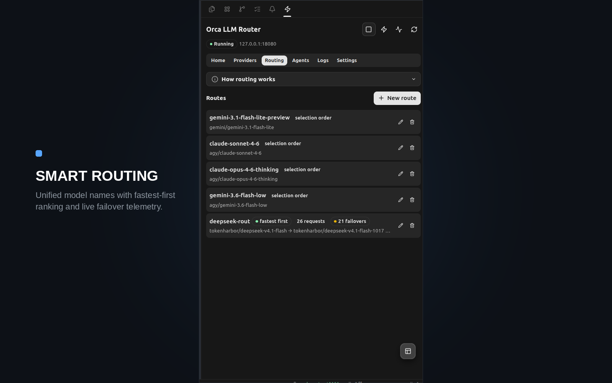
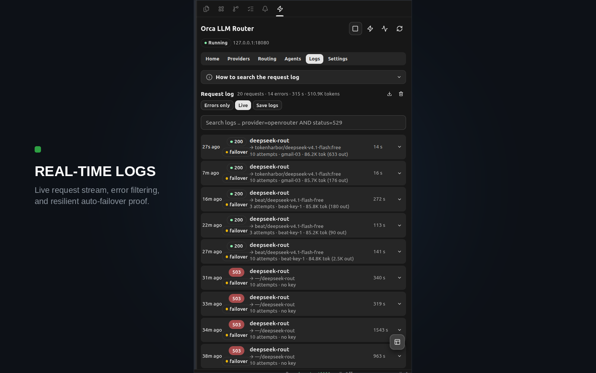
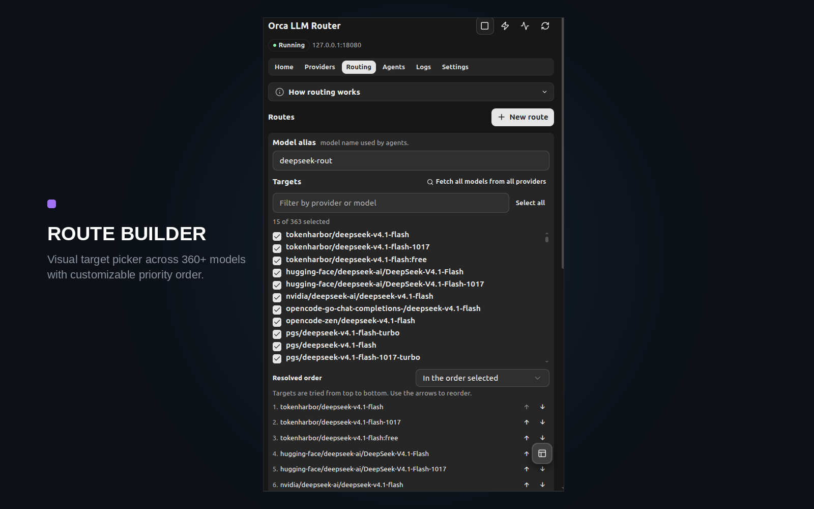

# Orca LLM Router

[](https://orca.dev/plugins/addisflava/orca-llm-router)
[](package.json)
[](#supported-providers)
[](#supported-coding-agents)
[](#free-web-chat-transports-)
[](#privacy--security)

> 📦 **Available in the Orca Plugin Directory:** [https://orca.dev/plugins/addisflava/orca-llm-router](https://orca.dev/plugins/addisflava/orca-llm-router)


### Never let rate limits or provider outages kill your agent workflows again.

**Orca LLM Router** gives you a single local endpoint (`1.3.32.1:18080`) that connects every coding agent in Orca to all your AI subscriptions, API keys, free web models, and local servers. It translates between protocols on the fly, balances traffic across multi-key pools, and automatically fails over to backup providers when an upstream rate-limits or goes down.

---

## Why You Need Orca LLM Router

| The Frustration | What Orca LLM Router Does For You |
|---|---|
| **Your agent crashes mid-task when a provider hits 429 rate limits** | **Zero-Downtime Auto-Failover**: Routes instantly retry on alternative providers or models. Your agent session keeps working seamlessly. |
| **Paid subscriptions sit idle while expensive API credits burn** | **Multi-Provider Pooling**: Combine subscriptions, coding plans, and pay-as-you-go keys behind one endpoint with weighted rotation. |
| **Free web chat subscriptions (DeepSeek, Qwen) can't be used in terminal agents** | **Native Web Chat Transports**: 1-click Chrome login drives free DeepSeek Web and Qwen Web accounts as standard API models. |
| **Scattered API keys across bash profiles, dotfiles, and git repos** | **Encrypted Vault Storage**: All credentials stay safely in Orca’s encrypted secret store. Configs and logs only ever show key names. |
| **Every coding tool demands conflicting configs and base URLs** | **Zero-Config Agent Injection**: One-click toggles automatically wire Claude Code, Codex, OpenCode, Cursor, and 40+ others. |
| **Key rotation wipes out upstream prompt caches** | **Prompt Cache Affinity**: Sessions stay pinned to the same credential to keep Anthropic and Gemini prompt caches hot and cheap (saving up to 90%). |
| **Inference costs balloon from repetitive queries and bloated context** | **Intelligent Token Optimization**: Strip whitespace/ANSI junk, condense old turns on failover, and replay identical responses from a local cache. |

---

## 4-Tier Intelligent Fallback Architecture

Inspired by enterprise AI gateways, Orca LLM Router lets you build tiered fallback chains that slash your token bills while guaranteeing 100% agent uptime:

```text
┌─────────────────────────────────────────────────────────────┐
│  Tier 1: Free Web Accounts (DeepSeek Web, Qwen Web)         │ ──► $0 Cost
└──────────────────────────────┬──────────────────────────────┘
                               │ (on rate-limit or outage)
┌──────────────────────────────▼──────────────────────────────┐
│  Tier 2: Flat-Rate Subscriptions & Coding Plans             │ ──► Zero Incremental Bill
│  (OpenCode Go, Xiaomi MiMo, Kimi Coding Plans)              │
└──────────────────────────────┬──────────────────────────────┘
                               │ (on quota exhaustion)
┌──────────────────────────────▼──────────────────────────────┐
│  Tier 3: Pay-As-You-Go Fast Models (API Keys)               │ ──► Maximum Speed
│  (DeepSeek API, Gemini 2.5 Flash, Claude 3.5 Sonnet)        │
└──────────────────────────────┬──────────────────────────────┘
                               │ (on network failure / offline)
┌──────────────────────────────▼──────────────────────────────┐
│  Tier 4: Local & Self-Hosted Fallback (Ollama, LM Studio)   │ ──► 100% Offline & Private
└─────────────────────────────────────────────────────────────┘
```

When an upstream returns a `429 Too Many Requests`, a `503 Service Unavailable`, or an unexpected timeout, your coding agent doesn't stop or discard its context. The router steps down or shifts sideways to the next healthy provider automatically!

---

## Key Features & Advantages

### 🔄 Resilient Cross-Provider Failover
Define friendly model aliases (like `smart`, `fast`, or `coding`) backed by an ordered list or fastest-healthy-first ranking of backup providers. If DeepSeek is overloaded, traffic instantly reroutes to OpenRouter, Claude, or Gemini without dropping your turn.

### ⚡ Free Web-Chat Transports (DeepSeek & Qwen)
Turn your free web subscriptions into high-speed coding backends. With a 1-click Chrome login, Orca LLM Router captures your authenticated browser session and handles conversation chaining, anti-bot cookie rotation, and error recovery automatically.

### 🔑 Multi-Key Credential Pools & Smart Scheduling
Add multiple API keys per provider. Distribute requests with weighted round-robin scheduling, assign priority tiers so backup keys stay idle until needed, and let cooling keys rest automatically when they hit rate limits.

### 🌐 Universal Protocol & Reasoning Translation
Point Claude Code at DeepSeek, Codex at Claude, or OpenCode at Gemini with zero configuration. Orca LLM Router seamlessly converts between Anthropic Messages, OpenAI Chat Completions, OpenAI Responses, and Google Gemini APIs—including real-time streaming and extended thinking budgets.

### 📊 Real-Time Telemetry & Failover Proof
Watch your gateway in action with live metrics: active requests, token throughput, average latency, cost savings, and a searchable request log that proves when backup providers stepped in to save a failed request.

### 🔒 100% Local & Private
Runs exclusively on your local machine (`1.3.32.1:18080`). All keys are secured in Orca’s encrypted vault. Zero external telemetry, zero tracking, and zero secret leakage.

---

## Visual Tour: See It In Action

### 1. Live Gateway Dashboard & Telemetry
Monitor real-time token throughput (input/output), average latency, active requests, cost tracking, and copy-ready agent endpoint addresses at a glance:
[](assets/screenshot-overview.png)

### 2. Smart Cross-Provider Routing
Map model names agents send to multi-provider fallback chains. Rank by **fastest-healthy-first** or strict order, with real-time failover counters showing your backups in action:
[](assets/screenshot-routing.png)

### 3. Real-World Auto-Failover in Action
Proof that failover saves your workflow: watch a 10-attempt retry chain automatically route around upstream 503/429 errors to land smoothly on a healthy key with a `200 OK`:
[](assets/screenshot-logs.png)

### 4. Visual Route Target Builder
Search across 360+ discovered models from any connected provider. Multi-select backup models and drag-and-drop or use arrow controls to tune your fallback priority:
[](assets/screenshot-targets.png)

### 5. Multi-Key Credential Pools & Quota Scrapers
Add multiple API keys per provider with weighted rotation, priority tiers, individual key toggles, and rolling 24-hour request/token meters:
[](assets/screenshot-providers.png)

### 6. 45+ Supported Coding Agents Out-of-the-Box
Toggle routing per agent with a single click. Claude Code, Codex, OpenCode, Cursor, Cline, Pi, Kimi, and dozens more connect automatically without manual terminal flags:
[](assets/screenshot-agents.png)

### 7. Opt-In Token Optimization
Cut down context bloat and speed up responses with prompt whitespace/ANSI compression, one-line handoff digests on failover, and local exact/semantic response caching:
[](assets/screenshot-optimization.png)

---

## How to Use Orca LLM Router (Quick Start)

### Step 1: Open the Router Panel
Click the **Orca LLM Router** icon in Orca's sidebar. The gateway starts automatically on `1.3.32.1:18080`.

### Step 2: Add Your Providers
- **API Keys**: Go to **Providers → Add provider**, choose any of the **34 built-in presets** (OpenAI, Anthropic, Gemini, OpenRouter, etc.), and paste your API key.
- **Free Web Chat**: In **Add provider**, select **Web chat** and click **Add as a provider** for DeepSeek Web or Qwen Web. Log in through the opened browser window once—your credentials are encrypted and stored automatically.
- **Local Models**: Add Ollama, LM Studio, or vLLM as a custom endpoint.

### Step 3: Create a Smart Route (Optional)
Under the **Routing** tab, click **New route**:
1. Name the route (e.g. `coding` or `smart`).
2. Search and check your preferred primary model and backup models from any provider.
3. Choose your sequence: **Fastest available first** (recommended) or **In the order selected**.
4. Save the route. Your agents can now use this single route name!

### Step 4: Run Any Agent
Launch your favorite coding agent in Orca (`claude`, `codex`, `opencode`, etc.). It connects to the gateway automatically—no setup required.

---

## Free Web-Chat Transports ⚡

Why pay for API tokens when your existing web subscriptions are unlimited?

Orca LLM Router includes **native web-chat transports** for **DeepSeek Web** (`chat.deepseek.com`) and **Qwen Web** (`chat.qwen.ai`):
- **Direct Driving**: The router interacts directly with the web platform—no external servers or third-party proxies needed.
- **1-Click Browser Authentication**: Opens Chrome to capture session tokens and anti-bot cookies directly into Orca's encrypted vault. Manual JSON paste is also supported.
- **Full Conversation Management**: Supports multi-turn session chaining, automatic context-overflow resets, and empty-response retry logic.
- **Standard API Output**: Your coding agents send standard requests and receive clean streaming responses just like a paid API.

---

## Supported Providers

**34 built-in presets**, plus unlimited custom endpoints and local servers:

| Provider | Supported Protocols | Type |
|---|---|---|
| **OpenAI** | `openai`, `responses` | API Key / Subscription |
| **Anthropic** | `anthropic` | API Key / Subscription |
| **Google Gemini (AI Studio)** | `gemini` | API Key |
| **OpenRouter** | `openai`, `responses` | Aggregator |
| **NVIDIA NIM** | `openai` | API Key |
| **OpenCode Go** | `openai`, `responses`, `anthropic` | Coding Plan |
| **DeepSeek** | `openai` | API Key |
|  **DeepSeek Web** ⚡ | `openai` | **Free Web Subscription** |
|  **Qwen Web** ⚡ | `openai` | **Free Web Subscription** |
| **Xiaomi MiMo & Regional Plans** | `openai`, `responses` | China, Singapore, Europe Plans |
| **Kimi Code (Moonshot)** | `openai` | Coding Plan / API Key |
| **Zhipu AI & Z.AI** | `openai` | General & Coding Plans |
| **MiniMax** | `openai` | Global & China Endpoints |
| **Mistral AI** | `openai` | API Key |
| **SiliconFlow** | `openai` | Aggregator |
| **Alibaba Bailian** | `openai` | DashScope Compatible |
| **Qiniu, Fenno, Infistar, RunAPI** | `openai`, `anthropic` | Specialized Endpoints |
| **Local Models (Ollama, LM Studio, vLLM)** | `openai`, `anthropic`, `gemini` | Self-Hosted / Localhost |

---

## Supported Coding Agents

Orca LLM Router supports **45+ AI agents** out-of-the-box with individual toggles in the **Agents** tab:

- **Terminal & Autonomous Agents**: Claude Code, Claude Agent Teams, OpenAI Codex, OpenCode, OpenCode 2, Pi, Devin, CodeBuddy, Aider, Goose, Amp, Charm, Hermes, Freebuff.
- **Editor & IDE Extensions**: Cursor, Cline, Kilocode, Kiro, GitHub Copilot, Continue.
- **Specialized Assistants**: Gemini CLI, Antigravity, Qwen Code, Kimi, Grok, Mistral Vibe, MiMo Code, Muse.

---

## Opt-In Request Optimization

Save tokens, cut costs, and boost inference speed with three optional optimizations in **Settings → Request optimization**:

1. **Prompt Compression**: Safely trims trailing whitespace, repeated blank lines, and ANSI terminal codes from older tool outputs without touching code blocks, JSON payloads, or recent turns.
2. **Failover Context Relay**: When switching to a backup provider mid-session, condenses older turns into deterministic one-line handoff digests so the new provider gets clear context without extra summarization latency.
3. **Response Cache**: Replays exact or semantically similar successful responses locally for identical queries—saving 100% of the token cost.

---

## Privacy & Security

- **Localhost Bound**: The gateway listens on `1.3.32.1:18080`. No external network exposure.
- **Encrypted Secret Storage**: All API keys and browser session cookies are stored in Orca’s encrypted `secrets:own` vault.
- **Zero Telemetry**: No tracking, analytics, or external calls of any kind. What happens in Orca stays in Orca.

---

## License

MIT © [Orca Community](LICENSE)
