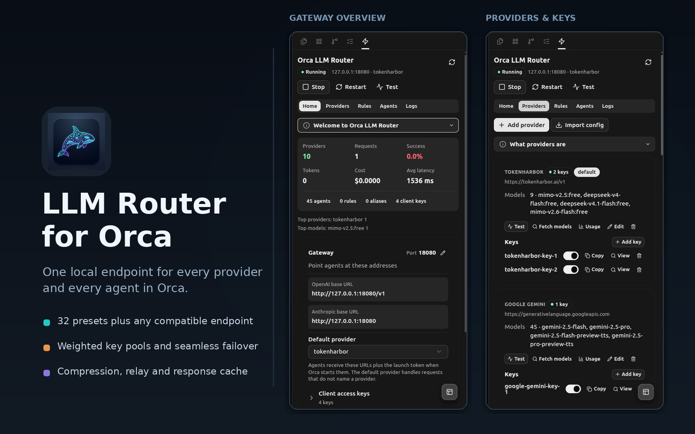
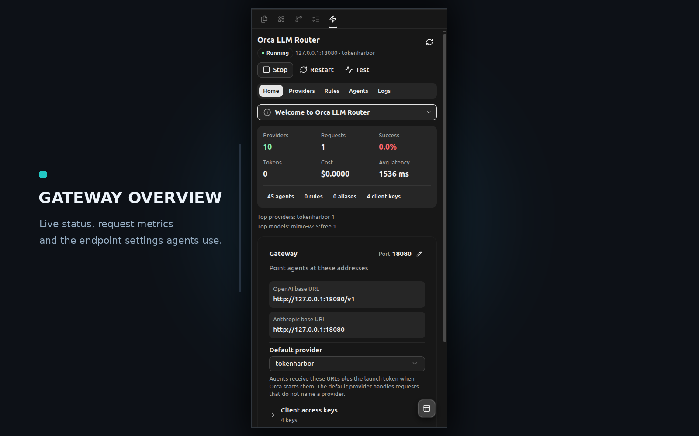
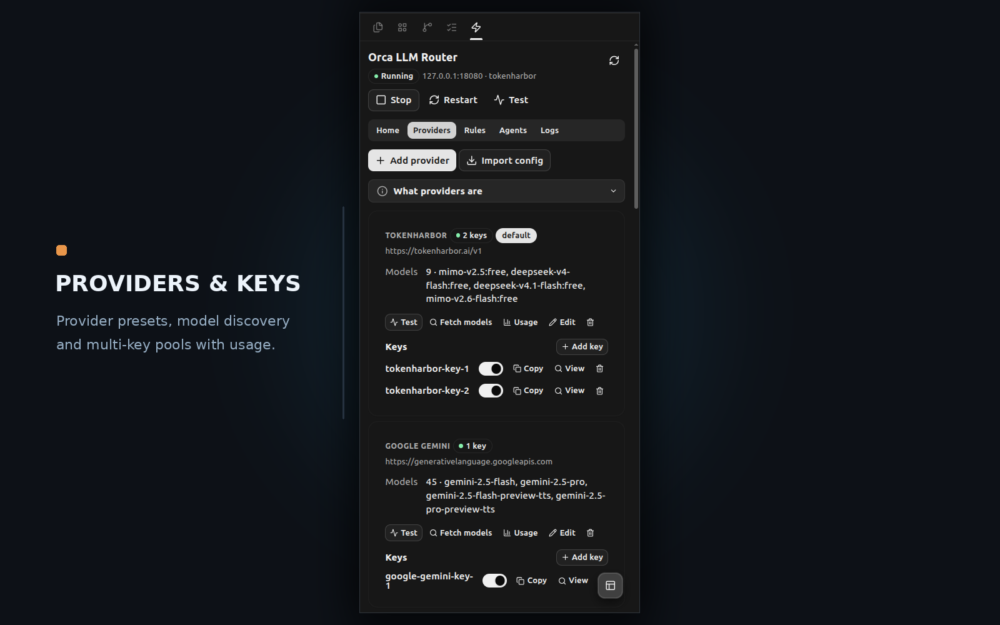

# Orca LLM Router

**Use all your subscriptions and API credits from any provider, coding plan, and local model on any agent in Orca — in one place, without leaving Orca.**

One stable local endpoint (`127.0.0.1:18080`) for every coding agent you run in Orca. **Orca LLM Router** points them at your providers, translates between protocols, rotates across your API keys, and automatically falls over to the next healthy target when a provider rate-limits, goes down, or runs out of quota.

**→ [Core Features](#core-features) · [Why Orca LLM Router?](#why-orca-llm-router) · [See it in the panel](#see-it-in-the-panel) · [Supported Providers](#supported-providers) · [Compatible Agents](#compatible-agents) · [Quick Start](#quick-start)**

---

## Why Orca LLM Router?

| The daily pain | What Orca LLM Router does about it |
|---|---|
| You hit a rate limit mid-coding session and the agent just dies | Routes retry the failing target, then fail over across providers automatically — your session keeps going |
| Subscriptions you pay for sit idle while API keys get hammered | One endpoint drains every subscription, key, and quota you have — weighted rotation spreads load across them all |
| Every API key lives in a different dotfile, or worse, in a repo | Keys are stored in Orca's encrypted secret vault; config files only ever reference key *names* |
| Claude Code wants one config, Codex another, OpenCode a third | A launch hook wires every Orca-launched agent to the gateway — no manual setup, no dotfile overwrites |
| Multi-key rotation keeps busting your prompt cache | Cache affinity pins each session to one credential, so cached prompts stay cached |
| One provider melts down and everything stalls | Circuit breakers, key cooldowns, and explicit exhaustion (`420 router_exhausted`) route around trouble instead of through it |
| No idea which key is about to run dry | Rolling per-key counters and provider-reported plan windows, visualized as usage bars in the panel |

---

## Core Features

- **Single Unified Endpoint**: Connects popular coding and AI clients (such as Claude Code, OpenAI Codex, OpenCode, Pi, Aider, Cursor, and Cline) to one local endpoint — no per-tool setup, no editing dotfiles. Orca LLM Router wires each agent up automatically when it launches.
- **Multi-Provider Aggregation**: **32 built-in presets** covering OpenAI, Anthropic, Google Gemini, OpenRouter, DeepSeek, NVIDIA, OpenCode Go, Xiaomi MiMo and its regional token plans, Kimi, Zhipu/Z.AI, MiniMax, Mistral, SiliconFlow, Alibaba Bailian, and more — plus any OpenAI-, Anthropic-, or Gemini-compatible endpoint you point it at. Mix subscriptions, API keys, and local models behind one address.
- **Smart Auto-Fallback**: A model name your agents send can resolve to an ordered list (or a fastest-healthy-first ranking) of provider/model targets. Targets are retried, then the next target takes over on 429s, 5xxs, timeouts, or open circuits — so a rate-limited provider never stalls your session.
- **Credential Pools with Smooth Weighted Rotation**: Add multiple keys per provider. Lower priority tiers serve first; a key with weight `3` gets roughly three times the traffic of weight `1`; higher-priority keys stay idle until the preferred tier is cooling, over its limit, or near a utilization threshold.
- **Automatic Cooldowns & Explicit Exhaustion**: Keys that hit 401/403 or 429 cool down automatically (honoring `Retry-After`). When every key is cooling or over quota, the gateway returns `420 router_exhausted` with `all_keys_exhausted` instead of silently reusing a blocked key.
- **Protocol & Format Translation**: Serves Anthropic Messages, OpenAI Chat Completions, OpenAI Responses, and Google Gemini native APIs, and translates between them on the fly. Point Claude Code at DeepSeek, Codex at Claude, or OpenCode at Gemini with zero code changes — including real-time SSE streaming across protocols.
- **Extended Thinking & Reasoning Parity**: Translates Anthropic `thinking` budgets into OpenAI `reasoning_effort` and DeepSeek `reasoning_content`, and maps reasoning blocks back into native Anthropic thinking blocks so Claude Code sees them correctly.
- **Multimodal Vision Translation**: Converts Anthropic base64 images into OpenAI `image_url` data URIs and Gemini `inlineData` parts automatically.
- **Prompt Cache Preservation**: Passes `anthropic-beta` caching headers through to Anthropic upstreams and pins a session to the same credential (via `x-orca-session-id`, agent session headers, body identifiers, or a stable prompt hash) so provider prompt caches stay warm.
- **Opt-in Prompt Compression**: Conservatively trims ANSI escapes, trailing whitespace, repeated blank lines, and old tool output before forwarding. Code fences, inline code, URLs, tool-call structure, system prompts, and recent turns are preserved by default. Off until enabled.
- **Context Relay on Failover**: When a request moves to another target, older turns become deterministic one-line handoff digests. No extra model call, no summarization latency; the next provider still receives the recent turns in full.
- **Exact & Semantic Response Cache**: Replay an identical successful response without touching a provider. Exact mode hashes the canonical request; semantic mode adds embeddings from an OpenAI-compatible provider and a configurable similarity threshold. Scoped by protocol, stream mode, and resolved target; tools are skipped by default, images are never cached, and requests above the temperature limit are ignored.
- **Per-Key Usage & Limits**: Rolling per-key counters (rpm/rph/rpd, tpm/tph/tpd), provider-reported plan windows where a scraper exists, and at-a-glance usage bars — so you can see which key has headroom before traffic fails. Providers without a built-in scraper get a one-click **Fetch usage** probe of common balance endpoints, plus a hand-editable usage connector (endpoint, auth, meter JSON paths) inside the provider's Edit form.
- **1-Click Migration from Legacy Routers**: Import providers, keys, models, aliases, routing rules, and agent profiles from Claude Code Router (`~/.claude-code-router`) or OmniRoute (including AES-256-GCM `enc:v1:...` credential decryption).
- **Cross-Provider Model Search**: Pull every configured provider's model catalog in one click (**Providers → Fetch all models**), filter across all of them at once, and save the ones you pick straight into each provider. In a route's target editor, **Fetch all models from all providers** merges the models that aren't saved yet into the same target list, marked *new*; picking one saves it to its provider when you save the route.
- **Local-First Privacy & Security**: Runs entirely on your machine on localhost. Provider credentials live in Orca's encrypted `secrets:own` vault — never in config files, logs, or upstream requests. Client gateway tokens are never leaked to providers. Zero telemetry.
- **Orca-Native Agent Integration**: No overwriting `~/.claude/settings.json` or global dotfiles — a per-session launch hook injects isolated environments, OpenCode gets a standalone gateway config, and Codex gets a dynamically injected model catalog.

---

## Request Optimization

All three features are **opt-in** and default to off. Enable them in **Settings → Request optimization**; per-request headers can override the compression and cache behavior.

| Option | What it does | What it never does |
|---|---|---|
| **Prompt compression** | Removes ANSI escapes, trailing whitespace, and repeated blank lines. Standard mode caps old plain-text tool output; aggressive mode also shortens old turns. | Never edits code fences, inline code, URLs, whole JSON payloads, tool-call arguments, images, or the most recent turns. `x-router-compression: off` skips it. |
| **Context relay** | On failover, replaces older turns with one-line deterministic digests (`[handoff] …`) before sending to the next target. | No hidden model call and no summarization cost. The system prompt and recent turns stay intact. `trigger: always` and `trigger: both` are available for large prompts. |
| **Response cache** | Replays a successful response (JSON or raw SSE) for an identical request. Exact mode uses a canonical SHA-256; semantic mode compares embeddings within the same scope and generation settings. | Skips tools by default and never caches images or requests above the temperature limit. Scoped by client protocol, stream mode, and resolved provider/model; in-memory and TTL-bounded. `x-router-cache: off` bypasses it. |

Notes:

- The cache lives in the running gateway; restarting the sidecar clears it.
- Semantic mode calls your chosen embedding provider on a cache miss, which adds one small request and its cost. It only matches when the prompt structure and generation settings (temperature, max tokens, stop, response format, tools) also match. Any embedding failure silently falls back to exact matching.
- Compression and context relay are deterministic: the same request and settings produce the same payload.
- Cache hits return `x-router-cache: hit` or `semantic-hit`. Compression and relay add `x-router-compression` and `x-router-context-relay` headers.

---

## See it in the panel

*Live gateway status, real-time metrics, and agent endpoint configuration — all in Orca's sidebar.*

*Provider presets, model discovery, and multi-key pools with per-key usage.*

---

## Supported Providers

**32 built-in presets**, plus a custom endpoint. Presets carry model catalogs and pricing data where available; some also include provider-specific usage scrapers.

| Provider | Protocols | Default Base URL |
|---|---|---|
| **OpenAI** | `openai`, `responses` | `https://api.openai.com/v1` |
| **Anthropic** | `anthropic` | `https://api.anthropic.com` |
| **Google Gemini (AI Studio)** | `gemini` | `https://generativelanguage.googleapis.com` |
| **OpenRouter** | `openai`, `responses` | `https://openrouter.ai/api/v1` |
| **NVIDIA** | `openai` | `https://integrate.api.nvidia.com/v1` |
| **OpenCode Go** | `openai`, `responses`, `anthropic` | `https://opencode.ai/zen/go/v1` |
| **DeepSeek** | `openai` | `https://api.deepseek.com` |
| **Xiaomi MiMo** | `openai`, `responses` | `https://api.xiaomimimo.com/v1` |
| **Xiaomi Token Plan (China)** | `openai`, `responses` | `https://token-plan-cn.xiaomimimo.com/v1` |
| **Xiaomi Token Plan (Singapore)** | `openai`, `responses` | `https://token-plan-sgp.xiaomimimo.com/v1` |
| **Xiaomi Token Plan (Europe)** | `openai`, `responses` | `https://token-plan-ams.xiaomimimo.com/v1` |
| **Kimi Code — Coding Plan** | `openai` | `https://api.kimi.com/coding/v1` |
| **Zhipu AI (China) — Coding Plan** | `openai` | `https://open.bigmodel.cn/api/coding/paas/v4` |
| **Zhipu AI (China) — General** | `openai` | `https://open.bigmodel.cn/api/paas/v4` |
| **Z.AI (Global) — Coding Plan** | `openai` | `https://api.z.ai/api/coding/paas/v4` |
| **Z.AI (Global) — General** | `openai` | `https://api.z.ai/api/paas/v4` |
| **MiniMax (Global)** | `openai` | `https://api.minimax.io/v1` |
| **MiniMax (China)** | `openai` | `https://api.minimaxi.com/v1` |
| **Mistral AI** | `openai` | `https://api.mistral.ai/v1` |
| **Kimi API (China)** | `openai` | `https://api.moonshot.cn/v1` |
| **Kimi API (Global)** | `openai` | `https://api.moonshot.ai/v1` |
| **Alibaba Bailian** | `openai` | `https://dashscope.aliyuncs.com/compatible-mode/v1` |
| **SiliconFlow** | `openai` | `https://api.siliconflow.cn/v1` |
| **Qiniu AI** | `openai`, `anthropic` | `https://api.qnaigc.com` |
| **Fenno.ai** | `openai`, `responses`, `anthropic` | `https://api.fenno.ai` |
| **Infistar** | `openai` | `https://infistar.ai/v1` |
| **RunAPI** | `openai`, `responses` | `https://runapi.co/v1` |
| **TeamoRouter** | `openai`, `responses`, `anthropic` | `https://api.teamorouter.com` |
| **Unity2.Ai** | `openai` | `https://unity2.ai/v1` |
| **code0.ai** | `openai`, `responses`, `anthropic` | `https://console.code0.ai` |
| **claudeapi** | `anthropic` | `https://gw.claudeapi.com` |
| **Y-API** | `openai`, `anthropic` | `https://api.y-api.bestvirtualgoods.com/v1` |
| **Ollama or any local server** | `openai`, `anthropic`, `responses`, `gemini` | Custom — e.g. `http://127.0.0.1:11434/v1` |

---

## Compatible Agents

Any agent Orca can launch — **45 built in**, each toggleable per agent in the **Agents** tab. Highlights: Claude Code, OpenAI Codex, OpenCode, Gemini CLI, GitHub Copilot, Cursor, Cline, Kilocode, Kiro, Aider, Goose, Amp, Charm, Continue, Qwen Code, Kimi, Grok, Mistral Vibe, MiMo Code, Pi, Devin, CodeBuddy, and many more.

- **Launch agents** (Claude Code, Codex, OpenCode, Pi, Aider, …) get the gateway injected per session via Orca's `agent.launch.before` hook — isolated environment, no dotfile edits.
- **Codex** additionally gets a dynamically injected model catalog (`-c model_catalog_json` for terminal launches, a managed `~/.codex/config.toml` block for Orca-native chat).
- **OpenCode** gets a published standalone config because it ignores per-launch env.
- **Claude Code** gets Anthropic-compatible base URLs and model env vars, so `/model` picks gateway models.

---

## Quick Start

1. **Install in Orca** — load the plugin as a live development plugin or from the directory (`onorca.dev/plugins`).
2. **Add a provider** — open the **Orca LLM Router** panel, pick a preset, and paste your API key. Keys are encrypted and stored in Orca's secret store.
3. **(Optional) Name a model** — create a **route** under **Routing**, e.g. `smart`, backed by any number of provider/model targets. Agents just send `smart`.
4. **(Optional) Turn on optimization** — in **Settings → Request optimization**, enable prompt compression, failover context relay, or the response cache.
5. **Launch any agent** — `claude`, `codex`, `opencode`, and friends automatically route through the gateway.

---

## How Routing Works

- A **route** is a model name agents send (like `smart` or `fast`) backed by one or more `provider/model` targets. **Try sequence** picks fastest-available first (default, ranked by measured latency and circuit state) or the order you selected, with configurable retries per target.
- A model name that isn't a route maps to exactly one provider/model target and retries it — it never fails over to another provider on its own. A matching **Global Policy** can still append a fallback chain of routes and/or raw `provider/model` targets.
- Requests that match nothing return `404 model_not_found`.
- **Global Policies** (under **Settings**) can match on the request body (regex, exact, or field matching), rewrite fields, set a default model, and append a fallback chain.

---

## License

MIT © [Orca Community](LICENSE)
